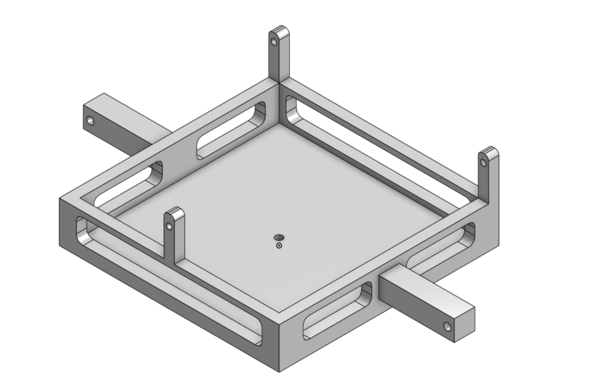
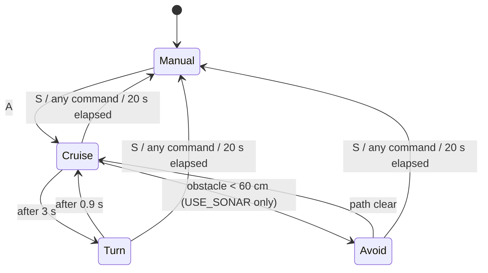

# Blimp

A three-motor blimp flown over Bluetooth from a phone or serial terminal, built around an Arduino Nano and an HC-05 module. Two horizontal motors steer by differential thrust and one vertical motor provides lift.

The original sketch was manual-control only. A first autonomous mode (a timed patrol, with optional obstacle avoidance) has been added on top of it.

## Chassis

The chassis is a square tray with:

- slotted walls along every side, cut out to remove material;
- four corner posts, each with a through-hole at the top;
- two arms projecting from opposite sides, each with a hole near the free end.

## Hardware

| Part | Notes |
|---|---|
| Arduino Nano | Main controller |
| HC-05 Bluetooth module | Serial link at 9600 baud |
| 3 DC motors | Each switched by a MOSFET from a PWM pin |
| HC-SR04 ultrasonic sensor | **Optional**, only for obstacle avoidance |

### Pins

| Pin | Function |
|---|---|
| D2 | HC-05 TX (Nano RX) |
| D3 | HC-05 RX (Nano TX) |
| D5 | Left motor (PWM, MOSFET) |
| D6 | Right motor (PWM, MOSFET) |
| D9 | Vertical motor (PWM, MOSFET) |
| D7 / D8 | HC-SR04 TRIG / ECHO (only with `USE_SONAR`) |

## Controls

Send a single character over Bluetooth.

| Command | Action |
|---|---|
| `F` | Forward (both horizontal motors) |
| `L` | Turn left (right motor only) |
| `R` | Turn right (left motor only) |
| `U` | Up (vertical motor) |
| `S` | Stop everything |
| `A` | Start autonomous patrol |

Manual commands expire after 500 ms, so the app needs to keep sending while a button is held. If the link goes quiet, the blimp stops.

`B` (back) and `D` (down) are not implemented. The motors are wired one-direction through MOSFETs, and reverse would need H-bridges.

## Autonomous mode

Send `A` to start. The blimp flies a simple open-loop patrol and reports `AUTO on`, `AUTO off` or `AUTO done` over the Bluetooth link.

- **Always ends:** a run stops by itself after 20 seconds (`AUTO_MAX_MS`).
- **Always interruptible:** any command other than `A` hands control back immediately.
- **No extra hardware needed:** without the sensor it is a timed cruise-and-turn pattern.
- **With a sensor:** uncomment `#define USE_SONAR` at the top of `blimp.ino`, mount an HC-SR04 facing forward, and the blimp turns right whenever something is closer than 60 cm.

### What it doesn't do yet

- No altitude control and no position or heading sensing; it is open-loop.
- The vertical motor is not used in autonomous mode.
- The timing constants (`CRUISE_MS`, `TURN_MS`, thrust levels) are starting values and will need tuning for your envelope and motors.

## Files

- [`blimp.ino`](blimp.ino): the sketch
- [`docs/chassis-cad.png`](docs/chassis-cad.png): chassis CAD render
