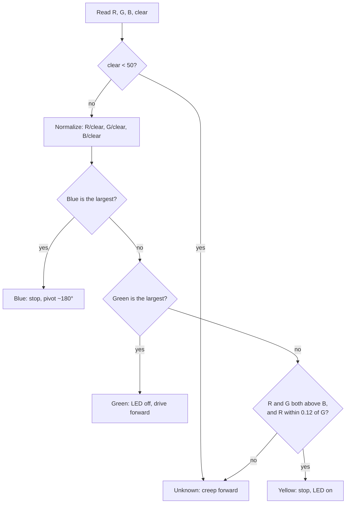

# Color Rover

A rover that reads the color of the ground with a TCS34725 sensor and chooses what to do for each color.

| Ground color | Behavior |
|---|---|
| Green | Keep exploring: drive forward |
| Blue | Turn around: stop briefly, then pivot about 180° |
| Yellow (sand) | Stop and light the LED |
| Anything else | Creep forward slowly |

## How it decides

Each loop the sketch reads the raw red, green, blue and clear channels. If the clear channel is very low (under 50) there isn't enough light to judge, and the reading counts as unknown. Otherwise each color channel is divided by the clear channel so the result doesn't depend on brightness, and the rules below are checked in order.

The yellow rule treats sand as "red and green about equal, blue lowest". Sensor settings are 50 ms integration time and 4x gain.

## Hardware and pins

| Part | Connection |
|---|---|
| TCS34725 color sensor | I2C (SDA / SCL) |
| Left motor | D5 (PWM) |
| Right motor | D6 (PWM) |
| Indicator LED | D13 |

Requires the **Adafruit TCS34725** library. If the sensor isn't found at startup, the sketch prints `No sensor` on the serial port at 9600 baud and stops.

## Files

- [`color_rover.ino`](color_rover.ino)
