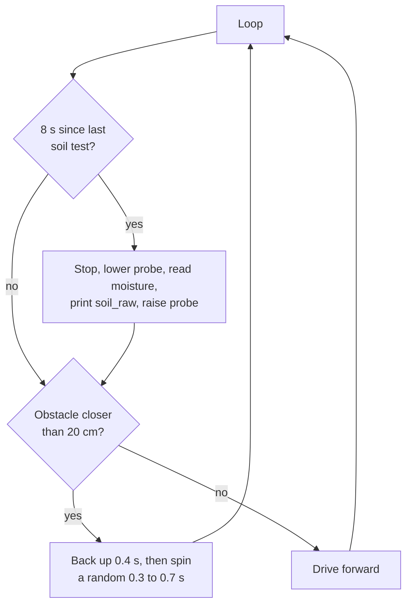

# Terrain Rover

A rover that roams on its own, avoids obstacles with an ultrasonic sensor, and periodically lowers a soil-moisture probe on a rack-and-pinion arm to take a reading.

## Behavior

- **Obstacle avoidance:** if something is within 20 cm, the rover reverses briefly and then turns by a random amount to pick a new heading.
- **Soil sampling:** every 8 seconds the rover stops, the servo drives the rack-and-pinion arm down, the moisture sensor is read, and the arm goes back up. Readings print on the serial port as `soil_raw=<value>` at 9600 baud.
- **Stream-bed detection:** this ran on a separate camera-based system and is not part of this sketch. Here it is replaced by the timer trigger, which can be swapped for a real detector.

## Hardware and pins

| Part | Pin |
|---|---|
| Ultrasonic sensor TRIG / ECHO | D7 / D8 |
| Left motor forward / reverse | D5 / D6 |
| Right motor forward / reverse | D9 / D10 |
| Probe arm servo | D11 |
| Soil moisture sensor | A1 |

Requires only the bundled `Servo` library.

## Files

- [`terrain_rover.ino`](terrain_rover.ino)
